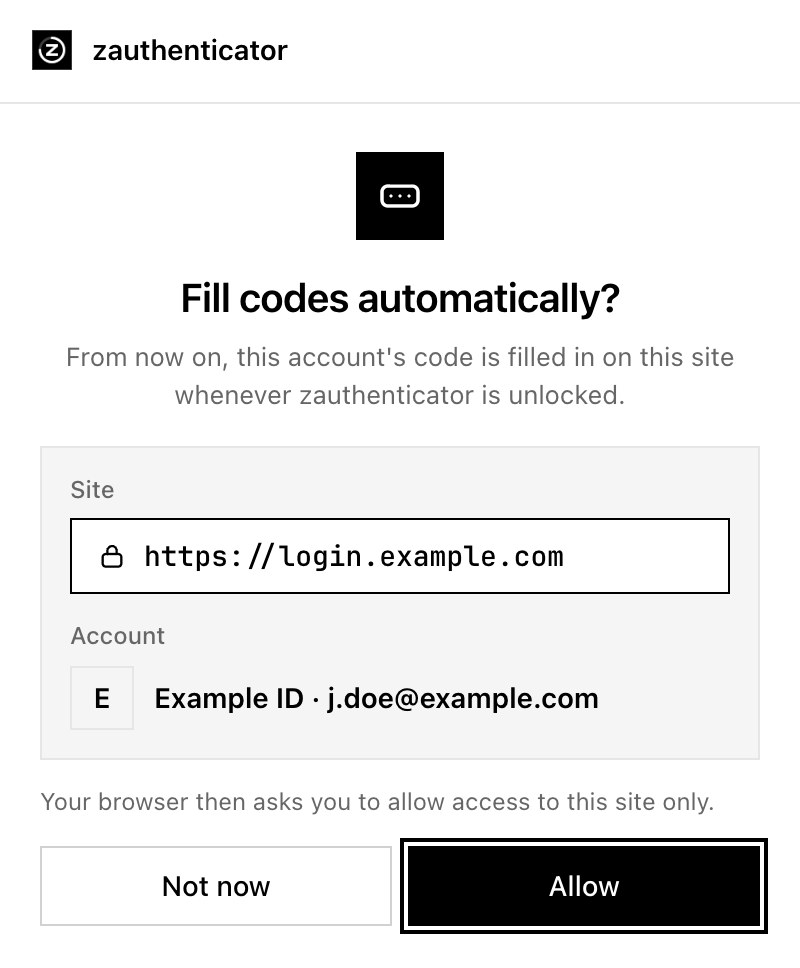
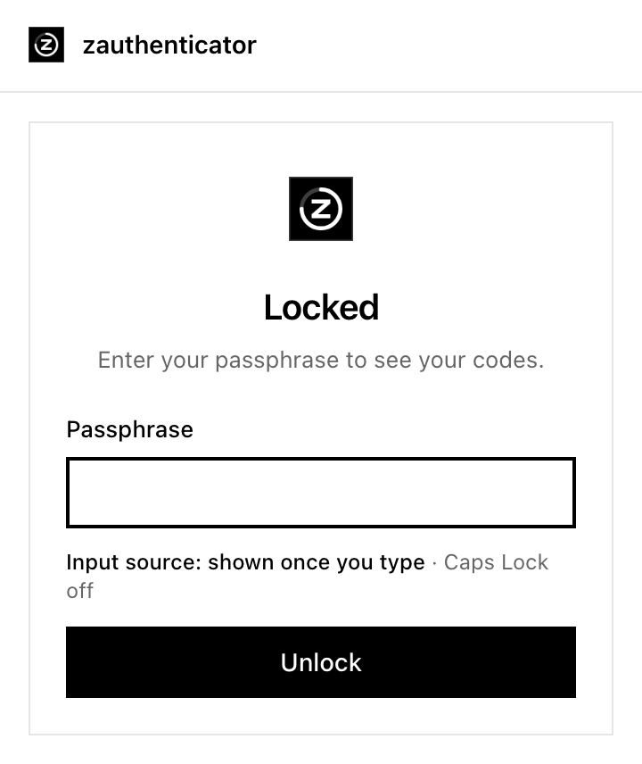

# zauthenticator

An open-source authenticator for Chrome and Edge: it shows your two-factor (TOTP) login codes in
the browser and keeps the secrets behind them on your device.

- **Open source, readable.** MIT license. Plain JavaScript with no bundler, no minifier and no
  npm dependencies at run time (one vendored QR decoder, pinned by hash), so you can read what
  runs.
- **Codes are made on your device**, from the secret key and your computer's clock.
- **No account, no sync, no telemetry.** The extension's own pages and its background worker
  cannot connect to any server.
- **Encrypted with your passphrase.** Secrets are stored only inside an encrypted vault, and the
  passphrase itself is never stored.
- **Optional auto-fill, one site at a time.** You choose the sites. A site gets the 6–8 digit
  code and nothing else.


[한국어 안내](#한국어) · [Privacy policy](PRIVACY.md) · [Security policy](SECURITY.md)

## Install

**From a store** (the easiest way; the browser keeps it updated):

- Chrome Web Store: coming soon (the link will be added here once the listing is live)
- Microsoft Edge Add-ons: coming soon (the link will be added here once the listing is live)

**Manually, from a release** (you run exactly the files you downloaded; nothing updates them):

1. Download `zauthenticator-<version>.zip` from
   [Releases](https://github.com/2lab-ai/zauthenticator/releases). The release notes give its
   sha256 if you want to check the download.
2. Unzip it into a folder you will keep. The browser loads the extension from that folder.
3. Open `chrome://extensions` or `edge://extensions` and turn on **Developer mode**.
4. Click **Load unpacked** and pick the unzipped folder (the one that contains `manifest.json`).

To update a manual install, replace the folder's contents with the new release and click the
reload icon on the extensions page. Keep the same folder: the browser derives the extension's id
from the folder's path, so a different folder loads as a different extension with an empty vault.

Things to know before you move or remove it:

- **A store install and a manual install are separate extensions** with separate vaults. To move
  your accounts, export a backup from one and import it into the other (see
  [Back up and restore](#back-up-and-restore)).
- **Uninstalling deletes the vault.** Export a backup first if you may want your accounts back.

## Use

### Set a passphrase

The first time you open the popup, you choose a passphrase of 8 characters or more. It encrypts
your accounts. **It cannot be recovered**: if you forget it, the saved accounts cannot be opened,
and neither can your backups, which are encrypted with the same passphrase.

### Add an account

Click **Add account** and use whichever your service gives you:

- **A QR code on the current page.** Open the page that shows the QR code, click the
  zauthenticator icon in the toolbar, and choose to scan this page. Only the visible part of the
  tab is read.
- **A QR code image.** Choose, drop or paste a screenshot or saved picture of the QR code.
- **An `otpauth://` link.** Paste one or more links, one per line.
- **A setup key.** Type the service, the account name and the secret key. The defaults (SHA-1,
  6 digits, 30 seconds) suit most services; **Advanced** changes them.

### Copy a code

Click a code to copy it. A countdown shows when the next code starts.

### Fill a code into a site

1. On the site, right-click the code field, choose **zauthenticator**, then the account. The
   current code is typed into that field. Nothing is submitted.
2. The first time you do this on an `https` site, a small window asks whether to fill this
   account's code automatically on that exact site. Click **Allow**, then accept the browser's
   own prompt for access to that one site. **Not now**, or declining the prompt, stores nothing.
3. On later visits, while zauthenticator is unlocked, the code field is filled for you.

After a fill, until you submit:

- **The code is kept current.** When the filled code expires, it is replaced with the new one, at
  most twice.
- **A rejected code is replaced once.** If the site rejects the code, a fresh one is filled once;
  the same code is never filled twice.
- **It is capped.** In one tab, a site gets at most 3 codes in 5 minutes.
- **It stops** as soon as you type or delete in the field yourself, when you leave the page, or
  when zauthenticator locks. It never submits a form.



Auto-fill works only on the exact site you allowed: the same scheme, host and port, on the page
itself or in a frame of that site inside another page. A subdomain or a look-alike domain gets
nothing. It fills only fields marked as a code field: a field the site
marks as a one-time code, a field whose name or label says OTP, 2FA, verification code and the
like, or a row of 6–8 one-character boxes labelled as a code. Fields that merely look like a code,
such as a PIN or a postal code, are left alone; use the right-click menu for those. Finding the
field is a best guess, so on an unusual page it may find nothing, or the wrong field.

To stop auto-fill on a site, open **Settings**, find the site under auto-fill sites and click
**Remove**. The extension also gives up its access to that site. Deleting an account removes its
sites too.

### Back up and restore

In **Settings**, **Export encrypted backup** saves a `.json` file. It is your vault as stored,
still encrypted with your passphrase. To restore, choose the file under **Import a backup** and
enter the passphrase that backup was made with. Import adds the backup's accounts (duplicates are
skipped); auto-fill sites are not imported, so set them again from the right-click menu.

### Lock

Click **Lock** to lock right away. zauthenticator also locks after 15 minutes without use, and
when the browser fully quits (on macOS, Cmd+Q; closing the windows is not enough). While it is
locked nothing is filled, and the right-click menu offers **Unlock zauthenticator…** instead of
your accounts.



## Privacy and security

**What stays on your device.** Your secret keys, account names and auto-fill sites are stored in
the browser's storage for this extension, inside a vault encrypted with a key made from your
passphrase. The passphrase is never stored. After you unlock, the key is held in the browser's
session memory until you lock or the browser quits; after 15 minutes without use it is removed
the next time anything asks for it (see the limits below). Nothing is sent to the developer or
anyone else; there is no server.

**What it reads from web pages.** Only when you click the button to scan
the current page, the extension takes one picture of the visible part of that tab (the browser
allows this for the tab where you just clicked the toolbar icon). The picture is decoded in the
popup by the bundled QR decoder and held in memory only for that; it is never stored or sent.
Only the account found in it, if it is a valid two-factor QR code, is added to your vault. On a
site where you allowed auto-fill, the auto-fill script reads the attributes of the page's input
fields (such as name, label and placeholder) to find the code field, and keeps none of it.

**What the browser itself records.** Outside the encrypted vault, the browser keeps the list of
sites you gave the extension access to (shown on the extension's details page) and the list of
sites its auto-fill script is registered for. Someone who can read your browser profile can see
those site names. If you installed from a store, the browser checks that store for updates, as it
does for every extension installed from there.

**What a site receives.** Only the 6–8 digit code, typed into its page: on a site you allowed, or
in the field you right-clicked. The site's scripts can read it, just as if you had typed it. The
secret key, the account name and your passphrase never reach the page.

**Permissions and why they are needed:**

| Permission | What it lets the extension do | Why |
|---|---|---|
| `storage` | Keep data in the browser's storage for this extension | To save the encrypted vault, and the unlocked key for the browser session |
| `activeTab` | Use the current tab, only right after you click the toolbar icon or choose an account in the right-click menu | To scan a QR code on the page you are looking at, and to type a code into the field you right-clicked |
| `contextMenus` | Add an item to the right-click menu of text fields | To let you choose which account's code to fill |
| `scripting` | Run the extension's own fill code in a page | To type the code into the field, and to register auto-fill for the sites you allowed |
| Access to `https` sites (optional) | Run the auto-fill script on a site | Nothing is granted at install. The browser asks you for one exact site when you click **Allow**, and the access is removed when you remove that site |

**Limits worth knowing:**

- The passphrase cannot be recovered, and it cannot be changed yet (planned). An exported backup
  is encrypted with the same passphrase, so restoring it needs that passphrase too: a backup
  protects you against losing the device or the browser profile, not against forgetting the
  passphrase.
- The computer's clock is the only time source. If codes are rejected, make sure the date and
  time are set automatically.
- There is no sync, by design. Each browser profile has its own vault; use export and import to
  move accounts.
- Someone who gets a copy of your browser profile or of a backup file can try to guess the
  passphrase offline. The key derivation makes each guess slow, but a long passphrase (several
  random words) is what keeps it out of reach.
- It does not protect against malware running as your user, a compromised browser or profile, or
  someone using your browser while it is unlocked. Copied codes sit in the system clipboard,
  where other applications can read them.
- No timer runs for the 15-minute lock. The unlocked key stays in the browser's session memory
  until the next thing that reads it (opening the popup, a menu choice or an auto-fill request);
  that read locks the vault and clears the key before any code is shown or filled. In the same
  way, if the browser's background worker was asleep when the 15 minutes passed, account names
  can stay in the right-click menu until it next wakes; choosing one then opens the unlock window
  instead of filling.

Full details: [Privacy policy](PRIVACY.md) · [Security policy and how to report a vulnerability](SECURITY.md) ·
[Verifying the trust claims](#verifying-the-trust-claims).

## Verifying the trust claims

The claims above can be checked from this repository. `npm run check` is a static gate
(`scripts/check-policy.mjs`) that reads the source and prints one `PASS`/`FAIL` line per rule;
`npm run e2e` loads the extension into a real Chromium and observes what it does. CI runs the unit
tests, the gate, the gate's self-test and the end-to-end test on every push and pull request, and
the release workflow runs the same job on the tagged commit before it publishes the zip.

| Claim | How it is enforced | How to check |
|---|---|---|
| No network from the extension | The CSP of extension pages and the worker is exactly `default-src 'none'; script-src 'self'; style-src 'self'; img-src 'self' data: blob:; connect-src 'none'; object-src 'none'; base-uri 'none'; form-action 'none'; frame-ancestors 'none'`. The source has no `fetch`, `XMLHttpRequest`, `WebSocket`, `EventSource`, `sendBeacon` or `RTCPeerConnection`, and the stylesheet no `@import` or remote `url(`. The content script runs inside web pages, where that CSP does not apply; it is held to a default-deny list instead: it reads fields, fills the code field, dispatches `input`/`change`, watches for changes, sets timers and asks the worker for a code, and creates no element, writes no `src`/`href`/style/markup, and uses no `postMessage`, worker, dynamic `import()` or `chrome` API beyond `runtime.sendMessage` and `runtime.id`. The function injected for a menu fill (`fillFocused`) is held to the same list and writes only if the frame is still on the origin the menu was opened on. | Read `content_security_policy` in `extension/manifest.json`. `npm run check` fails unless the CSP equals that policy, and on any of those APIs in any file, the content script included. `npm run e2e` calls `fetch()` from an extension page and from the worker, expects both blocked, and fails on any http(s) request during the run other than its own locally answered test pages. |
| Opens only its own pages | CSP does not govern navigation, so the gate also bans URL strings and navigation sinks (`window.open`, assigning `location`, links or forms pointing outside, frames, meta refresh). Opening a tab or window is done only in `extension/lib/nav.js` (the extension's own views), which the gate pins by sha256; elsewhere `chrome.windows` and every `chrome.tabs` method but `getCurrent` and `captureVisibleTab` are refused. | `npm run check`. `npm run e2e` records every page opened during the run and fails on any URL other than the extension's own pages, `about:blank` and its own test pages. |
| No remote or dynamic code | `script-src 'self'` without `unsafe-eval`, `unsafe-inline` or `wasm-unsafe-eval`; no `eval(`, `new Function`, `importScripts`, string timers, `javascript:` URLs, inline scripts or `on*=` handlers. | `npm run check` |
| Encrypted at rest | AES-GCM-256 with a key from PBKDF2-SHA-256 (600,000 iterations) over the NFC-normalized passphrase. `chrome.storage.local` holds only `{ v, kdf, iv, ct }`; auto-fill sites are inside the vault. | `npm run e2e` reads storage and the exported backup, and fails if a test secret appears in base32, hex, base64(url), as a byte list or raw bytes, if storage holds any key besides `local.vault` and `session.vaultKey`/`lastActiveAt`/`pendingBind`, or if a lock leaves anything in session storage. |
| Minimal permissions | `storage`, `activeTab`, `contextMenus`, `scripting`, and optional `https://*/*` granted one site at a time. No `host_permissions`, no content scripts in the manifest, no web-accessible resources; the one content script (`content/autofill.js` with `lib/fieldfind.js`) is registered at run time for the allowed sites only. | `npm run check` fails on any other permission or host pattern, on those manifest keys, on a background other than the `background.js` module worker, on `chrome.scripting` outside `lib/autofill-worker.js`, and on `chrome.permissions` outside that file and `popup/popup.js`. |
| Auto-fill only where you allowed it | Sites are bound by exact origin. The worker answers only this extension's own content script, from a frame whose origin is bound, while the vault is unlocked and not idle, and answers with the code and how long it stays valid, never account names or secrets. Auto-fill never submits a form and does not count as activity for the 15-minute lock. | `npm run e2e` part 3: a menu fill types the reference code; **Allow** stores the binding and registers the script for that origin only; a later visit is filled; another origin with the same page, a locked or idle vault, a removed site and a deleted account get nothing; no form is submitted. |
| Pinned third-party code | The only third-party code is the QR decoder jsQR 1.4.0, vendored unmodified, pinned by sha256, with its license beside it. | `cd extension/vendor && shasum -a 256 -c SHA256SUMS`; `npm run check` verifies the same. See [Third-party code](#third-party-code). |

**Limits of these checks.** The gate reads source text: it is a tripwire for this repository's
own files, not a proof, and the vendored decoder is checked by hash only (consistency with its
upstream release, not a review of its behaviour). Two known gaps: outside the content script, a
`/` that could be division or a regular expression is guessed rather than refused, so a contrived
one could hide a `js:`, `func:`, `files` or `css`, an alias of `chrome.scripting`, a call's
options, a rebinding of `fillFocused` or a global-object access from the scan; and an expression
that yields the global object without naming it (such as `document.defaultView`,
`globalThis.valueOf()`, `event.view`, or `this` in an event listener) can still be indexed by a
computed name, which checks that read `chrome.` by its spelling do not see. The end-to-end test,
which observes the requests made and the pages opened during its run, is the backstop.
`node scripts/check-policy.mjs --self-test` checks the gate itself: each deliberately broken copy
of the extension must fail the rule it breaks, and the gate's policy is compared with a second
copy written out separately, so it cannot be widened by editing one place.

Three things cannot be automated and are checked by hand: the browser's permission prompt after
**Allow**, the right-click menu itself (including a fill on a site the extension has no access
to), and a site's entry on the extension's details page before and after **Remove**.

### Third-party code

`extension/vendor/jsQR.js` is jsQR 1.4.0 (Apache-2.0): the file `dist/jsQR.js` of the npm package
`jsqr@1.4.0`, unmodified. Its license ships as `extension/vendor/jsQR.LICENSE`.

- npm registry integrity of `jsqr@1.4.0`:
  `sha512-dxLob7q65Xg2DvstYkRpkYtmKm2sPJ9oFhrhmudT1dZvNFFTlroai3AWSpLey/w5vMcLBXRgOJsbXpdN9HzU/A==`
- sha256 of `jsQR.js`: `bc40c8a15196236b2314db0856f72ca0b49980cd5413b8c852a7349f5fee0859`

To check it yourself, from the repository root:

```sh
npm view jsqr@1.4.0 dist.integrity             # the registry's integrity, as above
npm pack jsqr@1.4.0 --json | grep integrity     # the downloaded tarball's integrity, as above
tar -xzf jsqr-1.4.0.tgz package/dist/jsQR.js package/LICENSE
shasum -a 256 package/dist/jsQR.js extension/vendor/jsQR.js           # both bc40c8a1...
shasum -a 256 package/LICENSE extension/vendor/jsQR.LICENSE           # identical
rm -r jsqr-1.4.0.tgz package
```

## Development

Requires Node.js 20 or later. The only dev dependency is `playwright`, pinned to an exact version.

```sh
npm ci
npm test                                  # unit tests: RFC 6238 vectors, base32, otpauth, vault, auto-fill
npm run check                             # static trust gate
node scripts/check-policy.mjs --self-test # proves the gate catches each violation
npx playwright install chromium           # once, for the e2e browser
npm run e2e                               # real Chromium + the unpacked extension (E2E_HEADLESS=1 for headless)
npm run zip                               # dist/zauthenticator-<version>.zip and its sha256
```

To try a change, load the `extension/` folder with **Load unpacked**. `npm run e2e` drives the
popup through its DOM contract, compares the displayed and copied codes with an independent TOTP
implementation, and covers locking, the 15-minute idle lock, concurrent pages and the blocked
network; its copy checks put codes of test secrets on the clipboard. Screenshots go to
`test-results/` (or `E2E_ARTIFACTS`). The auto-fill part (`e2e/autofill.e2e.mjs`) runs on a test
copy of the extension whose manifest differs in two fields the gate refuses: a test service-worker
entry that runs the shipped `background.js` and exposes the menu handler (a click in the browser's
own menu cannot be automated), and the locally answered test sites as required host permissions,
so no permission prompt appears.

Releases are cut by pushing a tag `v<version>` that matches `extension/manifest.json`. The release
workflow runs the full CI job on the tagged commit, builds the zip, checks that it unpacks to
exactly `extension/`, and publishes it with its sha256. Only the publishing job can write to the
repository, and every action is pinned by commit SHA. That zip is what is uploaded to the stores;
the listing texts live in [`store/listing/`](store/listing/).

## License

[MIT](LICENSE). The vendored QR decoder keeps its own license (Apache-2.0), shipped as
`extension/vendor/jsQR.LICENSE`.

## 한국어

zauthenticator는 Chrome과 Edge에서 쓰는 오픈소스 2단계 인증(TOTP) 확장 프로그램이에요. 로그인할 때
필요한 인증 코드를 브라우저에서 바로 보여 주고, 코드를 만드는 비밀 키는 이 기기 밖으로 내보내지 않아요.

- **오픈소스**: MIT 라이선스예요. 번들러나 코드 압축 없이 평범한 JavaScript라서 실행되는 코드를 그대로 읽을 수 있어요.
- **코드는 이 기기에서 만들어요**: 비밀 키와 컴퓨터 시계만으로 계산해요.
- **회원 가입·동기화·사용 통계 수집이 없어요**: 확장 프로그램 화면과 백그라운드 워커는 어떤 서버에도 연결할 수 없어요.
- **마스터 비밀번호로 암호화해요**: 비밀 키는 암호화된 보관함 안에만 저장되고, 비밀번호 자체는 어디에도 저장하지 않아요.
- **자동 입력은 사이트마다 직접 허용해요**: 사이트가 받는 건 6–8자리 코드뿐이에요.

### 설치

- **스토어에서 설치**: Chrome 웹 스토어와 Microsoft Edge 추가 기능에 곧 올라가요(공개되면 여기에 링크를
  넣을게요). 스토어로 설치하면 브라우저가 알아서 업데이트해요.
- **직접 설치**: [Releases](https://github.com/2lab-ai/zauthenticator/releases)에서
  `zauthenticator-<버전>.zip`을 받아 계속 둘 폴더에 압축을 풀어요. `chrome://extensions`나
  `edge://extensions`에서 **개발자 모드**를 켜고 **압축해제된 확장 프로그램을 로드합니다**를 눌러 그 폴더(`manifest.json`이 있는 폴더)를
  고르면 돼요. 업데이트할 때는 같은 폴더의 내용을 새 버전으로 바꾸고 새로고침 아이콘을 눌러요. 확장
  프로그램 ID가 폴더 경로로 정해지기 때문에, 폴더가 바뀌면 빈 보관함을 가진 다른 확장 프로그램이 돼요.
- 스토어 설치와 직접 설치는 서로 다른 확장 프로그램이라 보관함도 따로예요. 계정을 옮기려면 한쪽에서
  백업을 내보내고 다른 쪽에서 가져오세요.
- 확장 프로그램을 삭제하면 보관함도 함께 지워져요. 삭제하기 전에 백업을 내보내세요.

### 사용법

- **처음 열 때** 마스터 비밀번호(8자 이상)를 만들어요. 비밀번호는 복구할 수 없으니 잊지 않도록 해 주세요.
  백업 파일도 같은 비밀번호로 암호화되기 때문에, 비밀번호를 잊으면 백업으로도 되살릴 수 없어요. 백업은 기기나
  브라우저 프로필을 잃었을 때를 위한 거예요.
- **계정 추가**: 지금 보고 있는 페이지의 QR 코드(툴바 아이콘을 눌러 스캔), QR 이미지, `otpauth://` 링크,
  설정 키 직접 입력 중 편한 방법을 쓰면 돼요.
- **코드 복사**: 코드를 클릭하면 복사돼요. 다음 코드까지 남은 시간도 보여요.
- **사이트에 입력**: 사이트의 코드 입력란에서 마우스 오른쪽 버튼을 누르고 **zauthenticator**에서 계정을
  고르면 현재 코드가 입력돼요(제출은 하지 않아요). `https` 사이트에서 처음 이렇게 하면 앞으로 이 사이트에서
  자동으로 입력할지 묻는 작은 창이 떠요. **허용**을 누르고 브라우저가 그 사이트 하나에 접근해도 되는지 물을 때
  동의하면, 다음부터는 잠금이 풀려 있는 동안 코드가 자동으로 입력돼요. **나중에**를 누르거나 브라우저 권한을
  거절하면 아무것도 저장하지 않아요.
- 자동으로 입력한 뒤 제출하기 전까지는 이렇게 해요. 입력한 코드가 만료되면 새 코드로 바꿔요(최대 두 번).
  사이트가 코드를 거부하면 새 코드로 한 번 다시 입력하고, 같은 코드를 두 번 넣지는 않아요. 한 탭에서 한
  사이트에 넣는 코드는 5분에 3개까지예요. 입력란에 직접 입력하거나 지우면, 그 페이지를 떠나면, 잠기면 바로
  멈춰요. 폼을 제출하지는 않아요.
- 자동 입력은 허용한 바로 그 사이트(같은 주소·포트)에서만 해요. 하위 도메인이나 비슷한 도메인에는
  입력하지 않아요. 코드 입력란이라는 표시가 있는 칸만 채우고, PIN이나 우편번호처럼 모양만 비슷한 칸은
  건드리지 않으니 그런 칸에는 오른쪽 클릭 메뉴로 넣어 주세요.
- 자동 입력을 그만하려면 **설정**의 **자동 입력 사이트**에서 **삭제**를 눌러요. 그 사이트에 대한 접근 권한도
  함께 반납해요.
- **백업**: 설정에서 암호화된 백업을 `.json` 파일로 내보내고, 가져올 때는 그 백업을 만들 때 쓴 비밀번호를
  입력해요. 계정만 가져오고 자동 입력 사이트는 다시 설정해야 해요.
- **잠금**: 잠그기 버튼을 누르거나, 15분 동안 쓰지 않거나, 브라우저를 완전히 종료하면(macOS는 Cmd+Q) 잠겨요.
  잠겨 있는 동안에는 아무것도 입력하지 않아요.

### 개인정보와 보안

- 비밀 키, 계정 이름, 자동 입력 사이트는 이 기기의 브라우저 저장소에 암호화된 채로만 있어요. 개발자에게도,
  다른 누구에게도 보내지 않아요.
- 브라우저는 확장 프로그램이 접근할 수 있는 사이트 목록과 자동 입력 스크립트가 등록된 사이트
  목록을 보관함 밖에 따로 기록해요. 브라우저 프로필을 읽을 수 있는 사람은 이 사이트 이름을 볼 수 있어요.
- 사이트가 받는 건 입력된 6–8자리 코드뿐이에요. 그 사이트의 스크립트는 직접 입력했을 때처럼 이 코드를 읽을 수 있어요.
- 팝업에서 페이지 스캔 버튼을 누를 때만 지금 탭의 보이는 부분을 한 장 캡처해요. 이 이미지는 팝업 안에서 QR
  디코더로 읽는 동안만 메모리에 있고, 저장하거나 보내지 않아요. 올바른 2단계 인증 QR 코드라면 거기서 찾은
  계정만 보관함에 추가해요. 자동 입력을 허용한 사이트에서는 코드 입력란을 찾으려고 입력란의 속성(이름,
  레이블, placeholder 등)을 읽어요.
- 권한: `storage`(암호화된 보관함 저장), `activeTab`(툴바 아이콘이나 오른쪽 클릭 메뉴를 쓴 그 탭에서만 QR
  스캔·코드 입력), `contextMenus`(오른쪽 클릭 메뉴), `scripting`(코드 입력과 자동 입력 등록), 그리고 허용한
  사이트 하나씩만 받는 선택적 `https` 사이트 접근이에요. 설치할 때는 어떤 사이트 권한도 받지 않아요.
- 컴퓨터 시계가 틀리면 코드도 틀려요. 기기 간 동기화는 일부러 넣지 않았어요. 백업 파일이나 브라우저 프로필을 가진
  사람은 비밀번호를 오프라인에서 추측해 볼 수 있으니 긴 비밀번호를 쓰세요.
- 자세한 내용은 [개인정보처리방침](PRIVACY.md)(영문), [보안 정책](SECURITY.md)(영문),
  [Verifying the trust claims](#verifying-the-trust-claims)에 있어요.

### 개발

`npm ci` 후 `npm test`, `npm run check`, `node scripts/check-policy.mjs --self-test`, `npm run e2e`,
`npm run zip`을 실행해요. 라이선스는 MIT예요.
